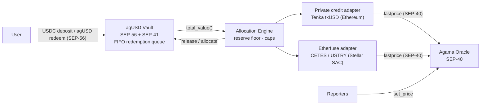

# Agama Stellar Vaults

Private credit yield vaults on Stellar, built on standards so they are simple to audit.

Users deposit USDC and receive **agUSD**, the vault share. agUSD is a **SEP-56** tokenized vault
(the Stellar equivalent of ERC-4626) and a **SEP-41** token, built on the
[OpenZeppelin Stellar Contracts](https://github.com/OpenZeppelin/stellar-contracts) library. It is the only
token in the protocol: yield shows up as a rising share price. There is no 1:1 dollar token and no staking step.



| Contract | Path | Standards |
| --- | --- | --- |
| agUSD vault | `contracts/vault` | SEP-56, SEP-41 (OZ `FungibleVault`, `FungibleToken`), OZ `Ownable`, `Pausable` |
| Allocation Engine | `contracts/allocation-engine` | OZ `Ownable`, `Pausable` |
| Oracle | `contracts/oracle` | SEP-40, OZ `Ownable` |
| Private credit adapter | `adapters/private-credit` | `StrategyAdapter`, reads SEP-40 |
| Etherfuse adapter | `adapters/etherfuse` | `StrategyAdapter`, holds the Stablebond SAC, reads SEP-40 |
| Shared interfaces | `crates/agama-interfaces` | SEP-40 types, adapter / engine / vault clients |

- How it works: [`docs/ARCHITECTURE.md`](docs/ARCHITECTURE.md)
- Trust model, invariants and open points for the audit: [`docs/SECURITY.md`](docs/SECURITY.md)

## Build and test

Requires Rust (see `rust-toolchain.toml`) and `stellar-cli` ≥ 25.2 (soroban-sdk 28 builds contracts through it).

```sh
stellar contract build      # all contracts -> target/wasm32v1-none/release/*.wasm
cargo test --workspace      # unit + integration tests
```

Testnet: [`scripts/deploy-testnet.sh`](scripts/deploy-testnet.sh) deploys and wires everything (addresses in
[`deployments/testnet.json`](deployments/testnet.json)); [`scripts/testnet_battery.py`](scripts/testnet_battery.py)
runs the end-to-end battery against it ([last run](deployments/testnet-battery.log)).

- Tenka source review vs deployed contracts: [`docs/TENKA_VERIFICATION.md`](docs/TENKA_VERIFICATION.md)

## License

Apache-2.0
